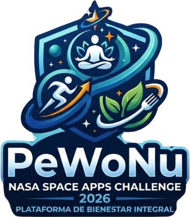

# PeWoNu

<p align="center">
  
</p>

**PeWoNu** (**Pe**ace, **WO**D, **Nu**trition) is a wellbeing prototype for astronauts on long missions, built for the NASA Space Apps Challenge 2026, "Create Health Monitoring Software for Astronauts on Space Missions". The internal Python package keeps its first name, `crew_self_check`.

> **Prototype with simulated, analog data.** It does **not** diagnose, predict disease, or replace medical care. Nothing here has been validated for use in space. The crew and all data in the demo are fictional and labeled as such.

## Quick start

One command installs everything (uv, the right Python, the code and every dependency) and starts the system. Nothing to set up by hand.

**Windows** (PowerShell):

```powershell
irm https://raw.githubusercontent.com/MrT-coder/pewonu/develop/install.ps1 | iex
```

**macOS and Linux**:

```sh
curl -LsSf https://raw.githubusercontent.com/MrT-coder/pewonu/develop/install.sh | sh
```

When it finishes, two pages open in your browser:

| System | Address | What it is |
|---|---|---|
| Astronaut app | http://127.0.0.1:8550 | Sign in with `AST-0001`, `AST-0002` or `AST-0003` (three simulated crew members, each with a different case) |
| Ground base | http://127.0.0.1:8560 | Mission control: shows only what the astronaut chose to send, after the communication delay |

Start it again any time from the install folder (`~/pewonu` by default):

```bash
cd ~/pewonu
uv run pewonu
```

Everything runs **on your computer only** and works **without internet** once installed. Requirements: Windows, macOS or Linux, and an internet connection for the first install. On Linux, the optional voice log needs the PortAudio system library (`sudo apt install libportaudio2`). The installer uses `git` when present and downloads an archive otherwise. Options: `PEWONU_DIR` (install folder), `PEWONU_BRANCH`, `PEWONU_NO_START=1` (install without starting).

<details>
<summary><b>Instalación rápida (español)</b></summary>

Un solo comando instala todo (uv, el Python correcto, el código y las dependencias) y arranca el sistema.

**Windows** (PowerShell):

```powershell
irm https://raw.githubusercontent.com/MrT-coder/pewonu/develop/install.ps1 | iex
```

**macOS y Linux**:

```sh
curl -LsSf https://raw.githubusercontent.com/MrT-coder/pewonu/develop/install.sh | sh
```

Se abren dos páginas: la app del astronauta (http://127.0.0.1:8550, códigos `AST-0001`, `AST-0002`, `AST-0003`) y la base en Tierra (http://127.0.0.1:8560). Para volver a arrancarlo: `cd ~/pewonu` y `uv run pewonu`. Todo corre solo en tu computador y funciona sin internet después de instalar. La interfaz tiene botón de idioma (English / Español).

</details>

<details>
<summary><b>Manual install</b> (if you prefer to do it step by step)</summary>

Requires Python 3.12+ and [uv](https://docs.astral.sh/uv/) (uv can download Python for you).

```bash
git clone https://github.com/MrT-coder/pewonu.git
cd pewonu
uv sync --extra astronaut --extra ground
uv run pewonu                                   # both systems, or run them separately:
uv run python -m crew_self_check.astronaut      # astronaut app, port 8550
uv run python -m crew_self_check.ground         # ground base, port 8560
```

`CREW_SELF_CHECK_GROUND_URL` changes the address the astronaut app sends to (empty turns the link off), `CREW_SELF_CHECK_DB` and `CREW_SELF_CHECK_GROUND_DB` choose the SQLite files (default `data/`), and `CREW_SELF_CHECK_MIC` chooses the microphone for the voice log (index or name).

</details>

## The idea

An astronaut is compared with **their own baseline**, not with a population average. Each body system is colored from the person's own history, and the system turns **gray when it does not have enough data to give an opinion**. It also says what to do and when to escalate to the crew medical officer or to the ground.

- **Three spaces:** Earth, spacecraft, planet (Mars in the demo). The baseline is kept per space.
- **Deterministic:** the rules that decide a status are explained in plain English and Spanish. There is **no AI model in the alert path**.
- **Private by default:** nothing leaves the astronaut without their confirmation.
- **Bilingual:** English and Spanish, switchable on every screen.

### The three pillars

| Pillar | What it does |
|---|---|
| **Peace** (mind) | Five-face mood check, a **guided manual pulse** ("pulse mission" that teaches the wrist technique and rewards good technique, never the pulse value), and an optional **voice log**: the audio is discarded on the device and only numeric acoustic measures are kept; no emotion is inferred. |
| **WOD** (move) | A workout of the day on the three machines of the International Space Station (T2 treadmill, CEVIS cycle ergometer, ARED resistive device) from age, weight and preflight bone density. Effort is perceived exertion; no loads or doses. |
| **Nutrition** (fuel) | A daily energy estimate next to the 1,900 to 3,200 kcal range the Canadian Space Agency describes for station dietitians, and a meal log built from illustrative foods by ISS food type. No score, no alert. |

### The two systems

- **Astronaut app** (Flet, local SQLite): body figure colored by each system's state, mission ring (Earth, spacecraft, planet), hazards view, summary, and a **share** step where the astronaut chooses what to send and confirms. What is sent is packed as an **HL7 FHIR R4** bundle, checked with the official HL7 validator.
- **Ground base** (FastAPI, SQLite): receives and validates the bundle, and shows it only after a **simulated communication delay** (12 minutes of mission time by default, configurable 0 to 22; the real one-way Earth to Mars delay is about 3 to 22 minutes). It shows state per crew member and what needs attention, never raw data or conversations.

### Not built yet

Routine reminders, the emergency screen, an adherence streak, and saving the meal log in the database (it lives in memory today). See [docs/tareas.md](docs/tareas.md).

## Repository layout

| Path | What it is |
|---|---|
| `src/crew_self_check/core` | Data contract, baseline engine, WOD and nutrition engines, FHIR mapping (pure Python, no I/O) |
| `src/crew_self_check/astronaut` | Astronaut app (Flet, local SQLite) |
| `src/crew_self_check/ground` | Ground base (FastAPI, SQLite) |
| `install.ps1`, `install.sh` | One-command installers |
| `docs/` | Idea, decisions, data contract, tasks, AI-use log, submission pack (Spanish, internal; the pack is English) |
| `research/` | Evidence behind the design, with verification labels |

## Development

```bash
uv sync --group dev --extra astronaut --extra ground
uv run pytest
uv run ruff check . && uv run ruff format --check .
uv run mypy
```

Rules for people and AI agents: [AGENTS.md](AGENTS.md). Tasks: [docs/tareas.md](docs/tareas.md). Decisions: [docs/decisiones.md](docs/decisiones.md).

## Data and sources

- All crew data in the demo is **fictional and simulated**, and is labeled as such in the app.
- NASA and partner-agency sources used for guidance are cited in the app and listed in the project page. Research notes with verification labels are in `research/`.
- Population reference for resting heart rate: NCHS National Health Statistics Reports No. 41 (NHANES 1999-2008), six adult rows, labeled in the app. Details: [docs/pulso-referencia.md](docs/pulso-referencia.md).
- Manual pulse technique: [MedlinePlus (NIH)](https://medlineplus.gov/ency/article/003399.htm).
- Heart-rate export follows the [HL7 FHIR R4 Heart Rate profile](https://hl7.org/fhir/R4/heartrate.html), checked with the official HL7 validator.
- Exercise and food: the ISS machines and the food categories come from NASA; the energy range from the Canadian Space Agency. The food list in the app is **illustrative, not the real menu**. Sources and their verification status: [docs/submission-pack.md](docs/submission-pack.md), section 2b.

## Use of AI

AI ("Super Intelligence") tools were used in this project, and we say where:

- **Code, tests and documentation:** written and reviewed with Claude Code (Anthropic). A person reviews and understands everything that is committed.
- **Research notes:** collected with NotebookLM (Google).
- **Images:** the pulse-guide illustrations in `src/crew_self_check/astronaut/assets/pulse/` were generated with Gemini and edited with Meta AI, by Kevin Toalombo. They are AI-generated and contain no NASA branding.

The full log is in [docs/uso-de-ia.md](docs/uso-de-ia.md) and is summarized on the project page. Text for the NASA form and the slides: [docs/submission-pack.md](docs/submission-pack.md).

## License

*To be decided by the team before the submission.*
